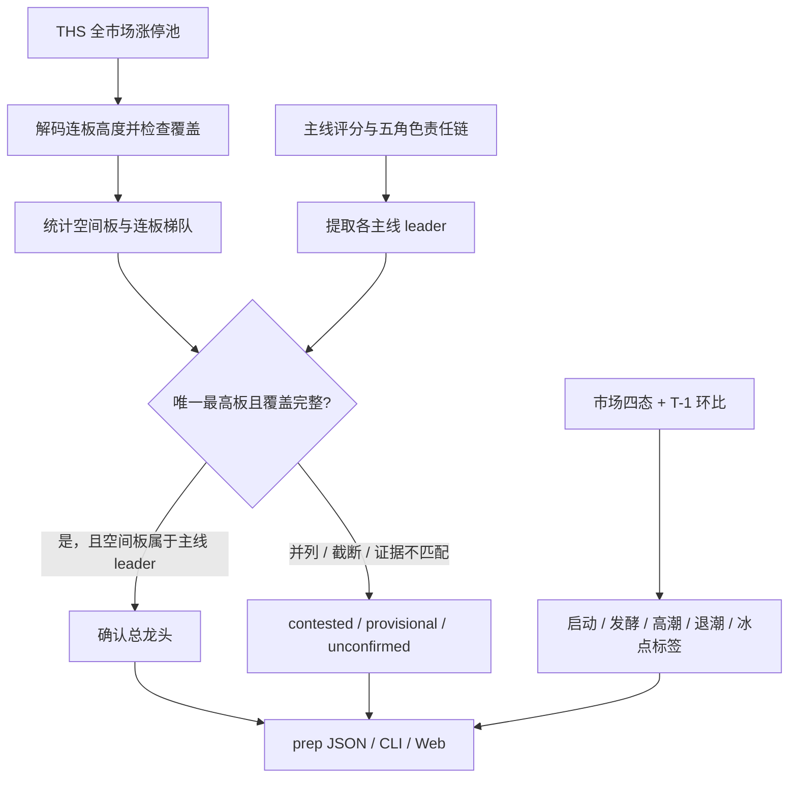

# 空间板与总龙头交叉验证

## 目标

在已有 prep 市场情绪、主线评分和五角色责任链之上，增加全市场连板梯队和总龙头交叉验证。新增层只输出证据和候选状态，不改变评分门禁、仓位计算或交易执行。

## 数据流程

## 判定合同

1. 空间板和梯队只来自 ths_limit_up_pool.rows，高度复用 infra.board_height.parse_board_height。
2. coverage.complete 必须满足：资产存在、total 有值、未标记 truncated，且已观测代码数不小于上游 total。
3. 总龙头只在完整覆盖、唯一最高板、该票同时是既有主线 leader 时返回 identified。并列为 contested，覆盖不足为 provisional，证据不匹配为 unconfirmed。
4. 情绪阶段只使用现有市场四态和上一快照变化。启动/发酵依赖 T-1 比较；没有历史证据时返回待观察。此标签仅作解释，不作为买卖指令。
5. 结果是复盘 JSON 的增量字段，不改数据库 schema。旧快照可通过 prep --recompute 重建。

## 验证

离线单测覆盖唯一最高板确认、并列最高板、分页截断、缺少总数、空间板与主线 leader 不一致、打包高度解析、缺失涨停池和情绪周期无 T-1 的 unknown。
